<a href="https://harshil-haunted-portfolio.vercel.app"></a>

  
  
  

 

<picture><source media="(prefers-color-scheme: dark)" srcset="assets/title-experience-dark.svg"/><source media="(prefers-color-scheme: light)" srcset="assets/title-experience-light.svg"/>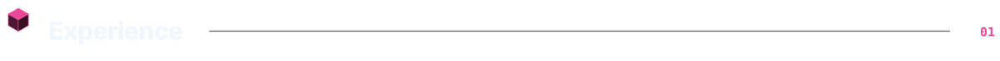</picture>



<b>Open the SSVL projects</b> — live sites and code

 

| Project | Links |
|---|---|
| HR Management System | [Live](https://human-resource-management-stsyem.vercel.app) · [Code](https://github.com/Harshil0207/HUMAN-RESOURCE-MANAGEMENT-STSYEM) |
| Auric Engineering | [Live](https://auric-engineering.vercel.app) · [Code](https://github.com/Harshil0207/Auric-Engineering) |
| Volume Electronics | [Code](https://github.com/Harshil0207/Volume-Electronic-Shop-) |
| Grocery Shop | [Code](https://github.com/Harshil0207/Grocery-Shop) |
| Littleland | [Code](https://github.com/Harshil0207/LittleLand-Toys-and-Books) |
| SmartBite | [Code](https://github.com/Harshil0207/SmartBite-DietFood-App-) |
| Fund Spinner | [Code](https://github.com/Harshil0207/Fund-Spinner) |
| Softys | [Code](https://github.com/Harshil0207/Softys-Admin-Page) |
| Tirupati Forged | [Code](https://github.com/Harshil0207/Tirupati-Forged-Company-) |
| Move Well | [Code](https://github.com/Harshil0207/Move-Well-Physiotherapy-Fitness) |
| Surgent Studio | [Code](https://github.com/Harshil0207/Surgent-Studio) |

MulticodeGenius projects are client work, so their code is private.

 

<picture><source media="(prefers-color-scheme: dark)" srcset="assets/title-featured-projects-dark.svg"/><source media="(prefers-color-scheme: light)" srcset="assets/title-featured-projects-light.svg"/>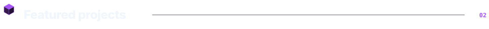</picture>

  <a href="https://harshil-haunted-portfolio.vercel.app"></a>
  <a href="https://raahi-fe-six.vercel.app"></a>
  <a href="https://two-eight-fe.vercel.app"></a>
  <a href="https://github.com/Harshil0207/NexaOS"></a>
  <a href="https://github.com/Harshil0207/Stock-Market-bot"></a>
  <a href="https://github.com/Harshil0207/Figma-clone"></a>

<b>More projects</b>

 

| Project | What it is | Links |
|---|---|---|
| LLM from Scratch | A small language model trained from first principles | [Code](https://github.com/Harshil0207/LLM) |
| Free-Roam 3D World | 3D portfolio with a walkable character and drivable car | [Code](https://github.com/Harshil0207/Personal_portfolio) |
| Go-Cart | Electronics store with an analytics dashboard | [Code](https://github.com/Harshil0207/Go-Cart-Shopping-Website) |
| Invoice Billing | Invoices with barcodes and PDF download | [Code](https://github.com/Harshil0207/InvoiceBilling) |
| Stock Analysis | Stock market dashboard | [Code](https://github.com/Harshil0207/Stock-Analysis-fe) |
| Evo Gym | Animated gym website | [Live](https://evo-gym-six.vercel.app) · [Code](https://github.com/Harshil0207/Evo-Gym) |

 

<picture><source media="(prefers-color-scheme: dark)" srcset="assets/title-skills-dark.svg"/><source media="(prefers-color-scheme: light)" srcset="assets/title-skills-light.svg"/></picture>

  

<picture><source media="(prefers-color-scheme: dark)" srcset="assets/title-github-activity-dark.svg"/><source media="(prefers-color-scheme: light)" srcset="assets/title-github-activity-light.svg"/></picture>

 

Thanks for stopping by ✦ Built with care by Harshil Gohil

