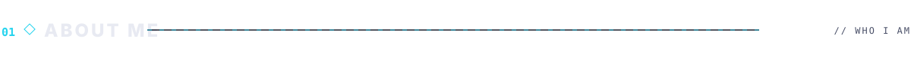
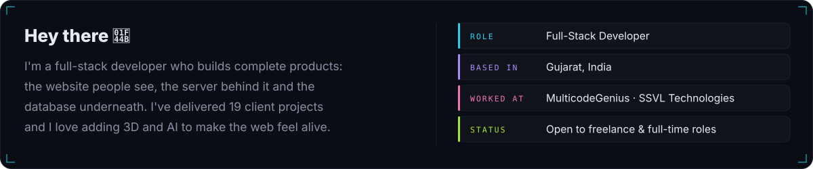
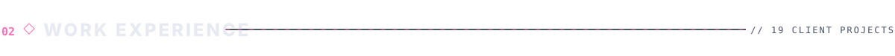
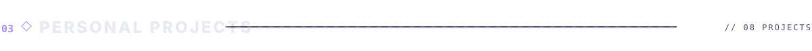
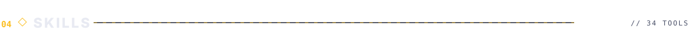
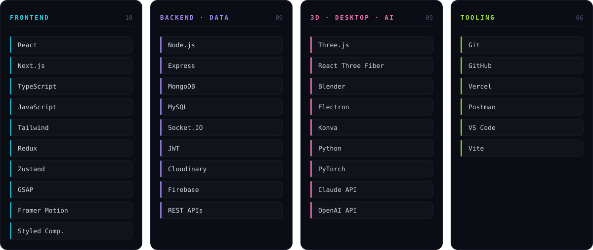

  

  
  
  

 

  

Company projects — the source code belongs to the clients and is private.

<b>&nbsp;🔗 Open the SSVL projects (live sites & code)</b>

 

| Project | What it is | Links |
|---|---|---|
| HR Management System | Manages employees, attendance and payroll | [Live ↗](https://human-resource-management-stsyem.vercel.app) · [Code](https://github.com/Harshil0207/HUMAN-RESOURCE-MANAGEMENT-STSYEM) |
| Volume Electronics | Online shop for electronics | [Code](https://github.com/Harshil0207/Volume-Electronic-Shop-) |
| Grocery Shop | Grocery store with products and cart | [Code](https://github.com/Harshil0207/Grocery-Shop) |
| Auric Engineering | Forging and engineering company website | [Live ↗](https://auric-engineering.vercel.app) · [Code](https://github.com/Harshil0207/Auric-Engineering) |
| Littleland | Toy and book shop with admin panel | [Code](https://github.com/Harshil0207/LittleLand-Toys-and-Books) |
| SmartBite | Admin panel and backend for a diet food app | [Code](https://github.com/Harshil0207/SmartBite-DietFood-App-) |
| Fund Spinner | Fund Spinner web app | [Code](https://github.com/Harshil0207/Fund-Spinner) |
| Softys | Full MERN-stack admin dashboard | [Code](https://github.com/Harshil0207/Softys-Admin-Page) |
| Tirupati Forged | Steel forging company website | [Code](https://github.com/Harshil0207/Tirupati-Forged-Company-) |
| Move Well | Physiotherapy and fitness clinic website | [Code](https://github.com/Harshil0207/Move-Well-Physiotherapy-Fitness) |
| Surgent Studio | Creative studio website | [Code](https://github.com/Harshil0207/Surgent-Studio) |

 

  
  
  
  
  
  
  
  

Click any card to open it · <b>LIVE</b> = you can try it online · <b>CODE</b> = view the source code

<b>&nbsp;➕ More projects</b>

 

| Project | What it is | Links |
|---|---|---|
| Go-Cart | Electronics store with an analytics dashboard | [Code](https://github.com/Harshil0207/Go-Cart-Shopping-Website) |
| Invoice Billing | Creates invoices with barcodes and PDF download | [Code](https://github.com/Harshil0207/InvoiceBilling) |
| Stock Analysis | Stock market dashboard | [Frontend](https://github.com/Harshil0207/Stock-Analysis-fe) · [Backend](https://github.com/Harshil0207/Stock-Analysis-be) |
| Evo Gym | Animated gym website | [Live ↗](https://evo-gym-six.vercel.app) · [Code](https://github.com/Harshil0207/Evo-Gym) |
| Rolls International | Company website | [Live ↗](https://rolls-international.vercel.app) · [Code](https://github.com/Harshil0207/Rolls-International) |
| Saturn Jewellery | Jewellery brand website | [Code](https://github.com/Harshil0207/Saturn-Jewellery) |
| Mantra Diamonds | Diamond brand website | [Code](https://github.com/Harshil0207/Mantra-Diamonds) |

 

  

  

  <picture>
    <source media="(prefers-color-scheme: dark)" srcset="https://raw.githubusercontent.com/Harshil0207/Harshil0207/output/github-snake-dark.svg"/>
    <source media="(prefers-color-scheme: light)" srcset="https://raw.githubusercontent.com/Harshil0207/Harshil0207/output/github-snake.svg"/>
    
  </picture>

